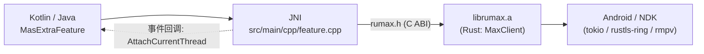

# 集成方案：将 rumax 集成到 Android 模块 `MasExtraFeature`

> 目标模块：`.../glyphixdebug/sdk/MasExtraFeature/android`
> 方式：把 Rust 的 `rumax`（Max Messenger 客户端）作为**预编译静态库**接入现有 Native（JNI）层。
>
> **状态：已实现。** 方案 A（静态链接）、ABI `arm64-v8a + armeabi-v7a`、含通用事件回调；预编译产物输出到模块 `jniLibs`。

---

## 1. 目标与总体思路

在**不改动 rumax 现有 Rust 实现**的前提下，将其交叉编译为 Android 静态库 `librumax.a`，
再由模块内已有的 `feature.cpp` 通过 **C ABI**（`include/rumax.h`）调用，并统一以 **JNI** 暴露给 Kotlin/Java。



**为什么这样接**：目标模块已经是「CMake + `feature.cpp`(JNI) + `version_script` 只导出 JNI 符号」的结构，且已有从 `internal/build/android/<abi>/{include,lib}` 取预编译库并链接 `mas-extra` 的先例。把 rumax 按同样方式静态链接进去，改动最小、产物单一。

---

## 2. 现状（目标模块事实）

| 项 | 内容 |
|----|------|
| Gradle | `com.android.library`，`minSdk 21` / `compileSdk 35`，`jniLibs.srcDirs = ['src/main/jniLibs']` |
| Native 项目 | CMake `project("masExtraFeature")` → 产出 `libmasExtraFeature.so` |
| JNI | `src/main/cpp/feature.cpp`，类 `com.xfaith.extra.feature.MasExtraFeature` |
| 符号导出 | `version_script.txt` **仅导出** `Java_com_xfaith_extra_feature_MasExtraFeature*` |
| 预编译库 | 取自 `../../../../internal/build/android/${ANDROID_ABI}/{include,lib}`；链接 `mas-extra`（`add_subdirectory(../../../../common)`） |
| ABI | `jniLibs/` 已有 `arm64-v8a`、`armeabi-v7a` |
| 页面大小 | arm64 已设 `-Wl,-z,max-page-size=16384 -Wl,-z,common-page-size=16384` |

---

## 3. 方案选择

| 方案 | 做法 | 优点 | 缺点 | 推荐 |
|------|------|------|------|:---:|
| **A. 静态链接** | 交叉编译 `librumax.a`，与 `feature.cpp` 一起链入 `libmasExtraFeature.so` | 单一 `.so`；符号被 `version_script` 自动隐藏；与 `mas-extra` 模式一致 | 需补链接 `dl/m` 等系统库 | ✅ **采用** |
| B. 独立 `.so` | 交叉编译 `librumax.so` 放入 `jniLibs/<abi>/` | 构建简单、解耦 | 多一个 `.so`；需额外做 16KB 页对齐与符号管理 | 备选 |
| C. Rust 直接做 JNI | 在 Rust 用 `jni` crate 导出 `Java_...` | 无 C++ 桥 | 与现有 `feature.cpp`/`version_script` 体系冲突，改动大 | 不采用 |

---

## 4. 构建：交叉编译 rumax

### 4.1 目标 ABI

与现有 `jniLibs` 保持一致：

- `aarch64-linux-android`（arm64-v8a）
- `armv7-linux-androideabi`（armeabi-v7a）

### 4.2 工具链准备

```sh
rustup target add aarch64-linux-android armv7-linux-androideabi
cargo install cargo-ndk          # 需要 ANDROID_NDK_HOME
```

### 4.3 构建命令

```sh
# 在 rumax 仓库根目录执行；输出到目标模块约定的 internal/build/android/<abi>/
cargo ndk \
    -t arm64-v8a \
    -t armeabi-v7a \
    -o <MasExtraFeature>/internal/build/android \
    build --release --lib
```

> 实际集成由模块内脚本 `android/scripts/build_rumax.sh` 完成，产物直接输出到本模块的 `jniLibs`：
> ```
> android/src/main/jniLibs/arm64-v8a/librumax.a      # 静态库（链接期使用）
> android/src/main/jniLibs/armeabi-v7a/librumax.a
> android/src/main/jniLibs/rumax.h                   # C ABI 头文件
> ```
> 构建：`RUMAX_DIR=<rumax 仓库> ./scripts/build_rumax.sh`（脚本自动探测 `ANDROID_NDK_HOME`）。
> 这些 `.a`/`.h` 仅用于编译期，已在 `build.gradle` 的 `packaging.jniLibs.excludes` 中排除，不会打进 aar。

（若不想用 cargo-ndk，可在 `.cargo/config.toml` 里把 NDK 的 `clang` 指定为对应 target 的 linker。）

### 4.4 release 配置（体积与正确性）

```toml
[profile.release]
lto = true
codegen-units = 1
opt-level = "z"
strip = true
panic = "unwind"   # 必须保持 unwind：FFI 层使用了 catch_unwind
```

### 4.5 产物

- `librumax.a`（Rust `staticlib`，已内含其依赖）
- `rumax.h`（来自 rumax 仓库 `include/rumax.h`）

---

## 5. CMake 集成

在 `src/main/cpp/CMakeLists.txt` 中改动（已落地）：

```cmake
# 1) 源文件增加通用事件桥
add_library(${CMAKE_PROJECT_NAME} SHARED
        feature.cpp
        NativeEventBridge.cpp)

# 2) rumax 静态库（由 scripts/build_rumax.sh 生成到 jniLibs）
set(RUMAX_JNI_LIBS "${CMAKE_CURRENT_SOURCE_DIR}/../jniLibs")
set(RUMAX_LIB "${RUMAX_JNI_LIBS}/${ANDROID_ABI}/librumax.a")
if(NOT EXISTS "${RUMAX_LIB}")
  message(FATAL_ERROR "rumax static lib not found: ${RUMAX_LIB}\nRun scripts/build_rumax.sh first.")
endif()
target_include_directories(${CMAKE_PROJECT_NAME} PRIVATE "${RUMAX_JNI_LIBS}")

# 3) 链接 rumax + Rust staticlib 需要的系统库
target_link_libraries(${CMAKE_PROJECT_NAME}
        android
        log
        mas-extra
        "${RUMAX_LIB}"
        dl
        m)
```

说明：

- 静态链接后，rumax 的 C ABI 符号会被 `version_script.txt` 的 `local: *` 隐藏，**只保留 JNI 符号**，无需额外处理。
- 现有 `-Oz -flto -fdata-sections -ffunction-sections -Wl,--gc-sections` 会进一步裁剪未使用的 rumax 代码。
- 16KB 页对齐：方案 A 由现有 arm64 链接参数覆盖；无需给 Rust 单独设置。

---

## 6. JNI 设计（`feature.cpp`）

### 6.1 单一 JSON 接口（`rumaxExec`）

rumax 对外只暴露**一个** JNI 方法，入参/出参都是 JSON 字符串，按 `type` 分发；
**永不抛出异常**，所有错误都通过返回值表达。

```java
public static native String rumaxExec(String requestJson);
```

**请求**：`{"type":"...", ...参数...}`
**响应**：
```json
{"success":true,  "data": <object|string|boolean|null>}
{"success":false, "error":{"type":"...","message":"..."}}
```

`handle` 以**字符串**传递（避免 JSON 数字精度问题）。

| type | 请求字段 | data（成功时） |
|------|----------|----------------|
| `version` | — | 版本号字符串 |
| `new` | — | 新句柄（字符串） |
| `free` | handle | null |
| `generateWebIdentity` | — | 身份对象 |
| `connect` | handle, identity(对象或字符串), mobile(bool) | null |
| `isConnected` | handle | bool |
| `disconnect` | handle | null |
| `setToken` | handle, token | null |
| `getToken` | handle | token 字符串或 null |
| `call` | handle, opcode(int), payload(对象或字符串) | `Response` 对象 |
| `loginByToken` | handle, syncState(可选) | LOGIN 响应对象 |
| `qrLoginRequest` | handle | QrLoginSession 对象 |
| `qrLoginConfirm` | handle, session(对象或字符串) | LOGIN 响应对象 |
| `sendMessage` | handle, chatId, text | 响应对象 |
| `event.bind` | handle | null |

常见错误 `type`：`InvalidRequest` / `UnknownType` / `InvalidHandle` / `ApiResponse`（服务端错误）/ `Internal`。

示例：
```java
String v = MasExtraFeature.rumaxExec("{\"type\":\"version\"}");
// {"success":true,"data":"0.2.1"}
String n = MasExtraFeature.rumaxExec("{\"type\":\"new\"}");
// {"success":true,"data":"140234..."}  ← handle
String r = MasExtraFeature.rumaxExec(
    "{\"type\":\"connect\",\"handle\":\"" + handle + "\",\"identity\":" + identityJson + ",\"mobile\":false}");
```

> 实现位置：分发逻辑在 `RumaxJsonApi.cpp`（与平台无关，已在主机上单测通过），`feature.cpp` 只做 JNI 包装。
> 接口对句柄做注册校验：伪造句柄返回 `InvalidHandle` 而非崩溃。

### 6.2 全局事件通知（唯一、不可销毁，已实现）

事件由 native 库在**发送时**带上自己的 `source`，桥只做转发；进程内**只有一个**监听器，
设置后**不可销毁**。

- `src/main/cpp/NativeEventBridge.h/.cpp`
  - `void gx_bridge_set_listener(JNIEnv*, jobject listener)` —— 设置全局监听器（重复设置仅替换，无销毁接口）
  - `void gx_bridge_on_event(const char* source, const char* json, void* user)` —— 通用 C 回调，可直接交给任何库
- `src/main/java/.../GxNativeEvent.java`：`void onNativeEvent(String source, String json)`
- `src/main/java/.../MasExtraFeature.java`：`setNativeEventListener(GxNativeEvent)`（设置一次即可）

用法（rumax 只是第一个使用者；今后接入其他库同样适用，库侧自行定义 `source`）：

```java
// 1) 全局设置一次（不可销毁）
MasExtraFeature.setNativeEventListener((source, json) -> {
    // source 由库侧定义，例如 "mas.rumax"；json 为事件内容
});

// 2) 让某个 rumax 客户端把事件转发到该全局通知
MasExtraFeature.rumaxExec("{\"type\":\"event.bind\",\"handle\":\"" + handle + "\"}");
```

内部机制：`gx_bridge_on_event` 按需 `GetEnv`/`AttachCurrentThread`，构造两个 `jstring` 后
`CallVoidMethod(listener, "onNativeEvent", source, json)`，并清理异常/`DeleteLocalRef`。

事件 JSON 形状：
```json
{ "type": "rx",  "response": { "ver":10, "cmd":0, "seq":0, "opcode":128, "payload": { ... } } }
{ "type": "log", "request":  { ... } }
```

> rumax 的 `source` 固定为 `"mas.rumax"`，由 Rust 侧在回调中定义（`rumax.h` 的 `rumax_event_cb` 含 `source` 参数）。
> 禁止在回调内调用阻塞的 API（`rumax_client_call` / `rumaxExec`），会因 runtime 重入死锁。

### 6.3 Java 使用示例（已实现）

对外使用**单一入口** `MasExtraFeature.rumaxExec(String)`（不抛异常，返回结构化 JSON）：

```java
// 0) 设置全局事件监听器（一次即可，不可销毁）
MasExtraFeature.setNativeEventListener((source, json) -> { /* 推送，source == "mas.rumax" */ });

// 1) 创建
String hResp = MasExtraFeature.rumaxExec("{\"type\":\"new\"}");
String handle = /* 从 hResp 的 data 取字符串 */;

// 2) 绑定事件到全局通知
MasExtraFeature.rumaxExec("{\"type\":\"event.bind\",\"handle\":\"" + handle + "\"}");

// 3) 连接（QR 需 WEB 身份 + WebSocket）
String idResp = MasExtraFeature.rumaxExec("{\"type\":\"generateWebIdentity\"}");
String identity = /* idResp.data */;
MasExtraFeature.rumaxExec("{\"type\":\"connect\",\"handle\":\"" + handle + "\",\"identity\":" + identity + ",\"mobile\":false}");

// 4) 二维码登录
String session = MasExtraFeature.rumaxExec("{\"type\":\"qrLoginRequest\",\"handle\":\"" + handle + "\"}");
// 展示 session.data.qrLink 二维码；然后（阻塞至扫码确认）：
MasExtraFeature.rumaxExec("{\"type\":\"qrLoginConfirm\",\"handle\":\"" + handle + "\",\"session\":" + sessionData + "}");

// 5) 业务调用：发消息 / 拉会话
MasExtraFeature.rumaxExec("{\"type\":\"sendMessage\",\"handle\":\"" + handle + "\",\"chatId\":1234567890,\"text\":\"hello\"}");
MasExtraFeature.rumaxExec("{\"type\":\"call\",\"handle\":\"" + handle + "\",\"opcode\":48,\"payload\":{\"chatIds\":[]}}");

// 6) 释放客户端（全局监听器不受影响）
MasExtraFeature.rumaxExec("{\"type\":\"free\",\"handle\":\"" + handle + "\"}");
```

---

## 7. 文件变更清单

| 文件 | 变更 |
|------|------|
| `android/scripts/build_rumax.sh` | **新增**：交叉编译 rumax（两个 ABI）并输出到 `jniLibs` |
| `android/src/main/jniLibs/<abi>/librumax.a` | **新增**（构建产物） |
| `android/src/main/jniLibs/rumax.h` | **新增**（C ABI 头文件） |
| `android/src/main/cpp/NativeEventBridge.h` / `.cpp` | **新增**：通用事件桥 |
| `android/src/main/cpp/RumaxJsonApi.h` / `.cpp` | **新增**：单一 JSON 接口的分发实现（与平台无关） |
| `android/src/main/cpp/CMakeLists.txt` | 修改：加 `NativeEventBridge.cpp`、`RumaxJsonApi.cpp`、rumax include/链接、`dl m` |
| `android/src/main/cpp/feature.cpp` | 修改：新增 `rumaxExec` JNI 包装（调用 `rumax_json_exec`）+ 事件桥入口 |
| `android/src/main/java/.../GxNativeEvent.java` | **新增**：通用事件监听接口 |
| `android/src/main/java/.../MasExtraFeature.java` | 修改：新增通用桥与 rumax 的 native 声明/封装 |
| `android/build.gradle` | 修改：`packaging.jniLibs.excludes` 排除 `*.a` / `*.h` |

---

## 8. 关键风险与注意事项

1. **16KB 页对齐**：方案 A 由现有 arm64 链接参数覆盖；若改用方案 B（独立 `librumax.so`），需给 Rust 加 `-C link-arg=-Wl,-z,max-page-size=16384`。
2. **`panic` 必须为 `unwind`**：FFI 层使用 `catch_unwind`，`panic=abort` 会使其失效。
3. **`ring` / `rustls` 的 Android 支持**：`ring` 支持 `aarch64`/`armv7` Android，`rustls`（ring provider）可直接用，无需 OpenSSL。
4. **系统库链接**：Rust `staticlib` 需要 `-ldl -lm`（bionic），必要时 `-llog`；若报未定义符号，可临时加 `-Wl,--no-undefined` 排查。
5. **体积**：`-fvisibility=hidden` + `version_script` + `--gc-sections` 会裁掉未使用的 rumax 代码；最终 `.so` 增量通常远小于 `.a`。
6. **ABI 与 minSdk**：Rust Android target 默认 API 21，与 `minSdk 21` 匹配；保持 `arm64-v8a`(+`armeabi-v7a`) 与现状一致。
7. **网络权限**：库模块不能声明权限，**app 需有 `INTERNET`**；协议全为 TLS（`wss` / TLS TCP），无需改 `network_security_config`。
8. **线程/阻塞**：`nativeQrLoginConfirm`、`nativeCall` 等在调用线程 `block_on`；不要在主线程做长阻塞调用（如等待扫码）。
9. **生命周期**：`nativeFree` 前先移除事件回调；确保 Rust 回调不再被触发后再释放句柄。
10. **工具链**：需 `cargo-ndk` 与 NDK（建议 r26+），并 `rustup target add` 两个 target。

---

## 9. 分步实施与工期

| 步骤 | 内容 | 状态 |
|------|------|:---:|
| 1 | 交叉编译 rumax（cargo-ndk，两个 ABI），产物输出到 `jniLibs`（`scripts/build_rumax.sh`） | 已完成 |
| 2 | 修改 `CMakeLists.txt`：加 `NativeEventBridge.cpp` + include + 链接 `librumax.a` + `dl/m` | 已完成 |
| 3 | `feature.cpp`：rumax JNI 方法 + 接入通用事件桥 | 已完成 |
| 4 | Java 封装（`GxNativeEvent`、`MasExtraFeature`） | 已完成 |
| 5 | 端到端验证（设备上连接、发消息、收推送、QR 登录） | 待设备验证 |

**合计约 1 周。**

---

## 10. 验证方式与结果

**已在开发机验证：**

1. **交叉编译**：`cargo ndk -t arm64-v8a -t armeabi-v7a` 成功；两个 ABI 的 `librumax.a` 均导出全部 19 个 C ABI 符号。
2. **C++ 编译**：用 NDK r28 的 `clang++` 对 `NativeEventBridge.cpp` 与 `feature.cpp` 做 `-fsyntax-only`：通过（无新增告警）。
3. **JNI 符号**：`feature.cpp` 的 17 个 `Java_com_xfaith_extra_feature_MasExtraFeature_*` 符号均为 GLOBAL，匹配 `version_script.txt`。
4. **链接**：把 `librumax.a` 链接进一个 Android 共享库成功，`NEEDED` 为 `liblog/libdl/libm/libc++_shared/libc`。
5. **体积**：`-Wl,--gc-sections` + `strip` 后，示例 .so 从 17.7MB 降到 572KB（实际增量取决于使用到的功能）。

**需在设备/模拟器上验证：**

- `rumaxVersion()` / `rumaxGenerateWebIdentity()` 返回正常；
- 连接握手 → `rumaxCall(48, "{\"chatIds\":[]}")` → `rumaxSendMessage(...)`；
- `GxNativeEvent.onNativeEvent("mas.rumax", json)` 收到推送；
- 两种 ABI 各跑一次加载与调用。

---

## 11. 已确认事项

1. 采用**方案 A（静态链接 `librumax.a`）**。
2. ABI：`arm64-v8a + armeabi-v7a`。
3. 需要**事件回调**，并已抽象为**通用事件桥**（`NativeEventBridge` + `GxNativeEvent`），可复用于后续接入的其他 native 库。
4. 预编译产物输出到 `android/src/main/jniLibs`（`librumax.a` 按 ABI；`rumax.h` 于根目录），并在 `build.gradle` 中排除打包。
