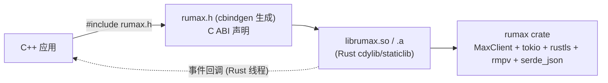

# 方案 A：Rust 核心 + C ABI 导出，供 C++ 调用

> 本文档描述「保持 Rust 实现不变，通过一层薄的 C ABI（`extern "C"`）导出，再给 C++ 提供一个轻量头文件封装」的接口设计方案：**需要实现哪些接口、各自做什么、C++ 如何调用**。
>
> 适用前提：C++ 侧通过链接 `cdylib`/`staticlib` 在**同一进程内**调用本库。

> **状态：已实现（v1）。** 代码位置：
> - `src/ffi.rs` — C ABI 实现（`pub mod ffi`）
> - `include/rumax.h` — C 头文件（手写；可用 `cbindgen.toml` 重新生成）
> - `examples/cpp_demo/` — C++ 示例 + CMake
> - `Cargo.toml` — `crate-type = ["cdylib", "staticlib", "rlib"]`
>
> 已验证：C++ 程序链接 `librumax.so`，可调用连接、事件回调、二维码请求/确认与通用 `call`。
>
> **业务接口逐条用法（含每个 opcode 的 payload 示例）见 [`CPP_API_USAGE.md`](CPP_API_USAGE.md)。**

---

## 1. 总体设计



三层职责：

| 层 | 内容 | 工作量 |
|----|------|--------|
| Rust 核心 | 现有 `MaxClient`（几乎不改） | 0 |
| C ABI 导出层 | 新增 `src/ffi.rs`（`extern "C"` 函数、运行时、内存/错误/回调管理） | ~500–900 LOC |
| C++ 封装 | `rumax.h`（cbindgen 自动生成）+ 可选 `rumax.hpp` RAII 包装 | ~200–400 LOC |

**核心设计决策（决定了工作量大小）：**

1. **窄边界**：不导出 116 个方法，而是导出**一个通用原语** `rumax_client_call(opcode, payload_json)` + 少量便捷函数。因为业务方法本质都是 `send_and_wait(opcode, payload)`。
2. **JSON 字符串跨越边界**：请求/响应 payload 本就是 `serde_json::Value`，直接以 UTF-8 JSON 字符串传递，**零类型映射成本**，且天然向后兼容。
3. **异步 → 阻塞 + 回调**：内部维护一个多线程 tokio runtime；`call` 用 `block_on` 实现同步调用；服务端推送经 C 回调转发。
4. **单一实现源**：协议变更只改 Rust 一处，C++ 侧无需跟进。

---

## 2. 需要实现的接口清单

### 2.1 类型与工具

| 接口 | 作用 |
|------|------|
| `typedef struct RumaxClient RumaxClient;` | 不透明句柄（内部为 `Box<Arc<MaxClient>>` + runtime + 回调） |
| `typedef void (*rumax_event_cb)(const char* event_json, void* user_data);` | 事件回调函数指针 |
| `void rumax_string_free(char* s);` | 释放由 Rust 分配的字符串（**必须**用它释放所有 `char*` 返回值） |
| `const char* rumax_version(void);` | 返回库版本（静态字符串，无需释放） |

### 2.2 生命周期

| 接口 | 作用 | 说明 |
|------|------|------|
| `RumaxClient* rumax_client_new(void);` | 创建客户端 | 内部初始化 tokio runtime 与 `MaxClient` |
| `void rumax_client_free(RumaxClient* c);` | 销毁客户端并释放资源 | 断开连接、停止后台任务、释放内存 |

### 2.3 配置与状态

| 接口 | 对应 Rust | 作用 |
|------|-----------|------|
| `int rumax_client_connect(RumaxClient* c, const char* identity_json, bool is_mobile, char** out_error);` | `connect(identity, is_mobile)` | 建立连接并握手（opcode 6）。`identity_json` 为 `Identity` 的 JSON；`is_mobile=true` 走 TCP/TLS(MessagePack)，`false` 走 WebSocket(JSON) |
| `void rumax_client_disconnect(RumaxClient* c);` | `disconnect()` | 断开连接 |
| `bool rumax_client_is_connected(const RumaxClient* c);` | `is_connected()` | 是否已连接 |
| `void rumax_client_set_host(RumaxClient* c, const char* host, uint16_t port);` | `set_host()` | 自定义服务器（测试用） |
| `void rumax_client_set_custom_ca(RumaxClient* c, bool enabled, const char* cert_path);` | `set_custom_ca()` | 自定义根证书（测试服务器） |
| `void rumax_client_set_token(RumaxClient* c, const char* token);` | `set_token()` | 设置登录 token |
| `char* rumax_client_get_token(RumaxClient* c);` | `get_token()` | 获取当前 token（可为 NULL） |
| `void rumax_client_set_user_id(RumaxClient* c, uint64_t user_id);` | `set_user_id()` | 设置当前用户 ID |

### 2.4 通用请求（核心）

| 接口 | 作用 | 说明 |
|------|------|------|
| `char* rumax_client_call(RumaxClient* c, uint16_t opcode, const char* payload_json, char** out_error);` | **同步**发送任意请求并返回响应 | 返回 `Response` 的 JSON；内部即 `send_and_wait(opcode, payload, 0)`；默认超时 10s |

- `payload_json` 为 `null` 或 `"{}"` 表示空载荷。
- 成功返回 `char*`（用 `rumax_string_free` 释放），`*out_error = NULL`。
- 失败返回 `NULL`，`*out_error` 指向错误 JSON（见 §4），同样用 `rumax_string_free` 释放。
- **注意**：不可在事件回调线程内调用（会死锁），见 §6。

> 用这一个函数即可覆盖 90% 业务：发消息 = `call(64, {...})`、拉历史 = `call(49, {...})`、拉会话 = `call(48, {...})`、表情回应 = `call(178, {...})` 等。

### 2.5 便捷高层接口（可选，但推荐）

把常用流程封装成独立函数，降低 C++ 侧拼 JSON 的出错率：

| 接口 | 对应 Rust / opcode | 作用 |
|------|-------------------|------|
| `int rumax_generate_web_identity(char** out_identity_json, char** out_error);` | — | 生成一个 `deviceType: "WEB"` 的随机身份（QR 登录必需） |
| `int rumax_client_login_by_token(RumaxClient* c, const char* sync_state_json, char** out_login_json, char** out_error);` | `sync()` (19/8) | 用 token 登录并增量同步；`sync_state_json` 可为 NULL |
| `int rumax_qr_login_request(RumaxClient* c, char** out_session_json, char** out_error);` | `qr_login_request()` (288) | 请求二维码，返回 `QrLoginSession` JSON（含 `qrLink`/`trackId`） |
| `int rumax_qr_login_confirm(RumaxClient* c, const char* session_json, char** out_login_json, char** out_error);` | `qr_login_confirm()` (289/291/19) | 传入 `rumax_qr_login_request` 返回的 `QrLoginSession` JSON，阻塞等待扫码并完成登录，返回 LOGIN 响应 JSON |
| `int rumax_send_message(RumaxClient* c, int64_t chat_id, const char* text, char** out_response_json, char** out_error);` | `send_message()` (64) | 发送文本消息的便捷封装 |

> 其余业务（群管理、文件夹、贴纸、通话、机器人等）**无需额外导出**，用 `rumax_client_call(opcode, json)` 即可。

### 2.6 事件订阅

| 接口 | 作用 | 说明 |
|------|------|------|
| `void rumax_client_set_event_callback(RumaxClient* c, rumax_event_cb cb, void* user_data);` | 注册事件回调 | 内部 `subscribe()` 并启动转发任务；`cb == NULL` 表示取消 |

推送格式（JSON，兼容现有 `subscribe()` 广播）：

```json
// 服务端推送（cmd=0 等）
{ "type": "rx",  "response": { "ver":10, "cmd":0, "seq":0, "opcode":128, "payload": { ... } } }
// 请求/响应日志
{ "type": "log", "request":  { ... } }
{ "type": "log", "response": { ... } }
```

### 2.7 异步变体（可选）

若 C++ 侧不想让调用线程阻塞在 `block_on` 上，可再加一组异步接口（用请求 id 关联完成回调）：

| 接口 | 作用 |
|------|------|
| `uint64_t rumax_client_call_async(RumaxClient* c, uint16_t opcode, const char* payload_json, rumax_done_cb cb, void* user_data);` | 提交请求，立即返回请求 id |
| `typedef void (*rumax_done_cb)(uint64_t req_id, const char* response_json_or_null, const char* error_json_or_null, void* user_data);` | 完成回调（在 Rust 线程触发） |

> v1 建议先只做同步 `call`，够用且简单；需要再补异步变体。

---

## 3. 汇编清单（建议的文件）

```
src/
  ffi.rs            # 新增：所有 #[no_mangle] extern "C" 函数 + 辅助
Cargo.toml          # 增加 crate-type = ["cdylib", "staticlib"]；可选 feature = "ffi"
cbindgen.toml       # cbindgen 配置（生成 rumax.h）
include/rumax.h     # 由 cbindgen 生成（提交到仓库便于 C++ 侧引用）
cmake/rumaxConfig.cmake  # 可选：供 C++ 项目 find_package
examples/cpp_demo/  # C++ 调用示例 + CMakeLists.txt
```

`src/ffi.rs` 内部结构建议：

```rust
struct FfiClient {
    runtime: tokio::runtime::Runtime,   // 多线程 runtime
    client: Arc<MaxClient>,             // 复用现有实现
    event_task: Option<tokio::task::JoinHandle<()>>,
}
```

---

## 4. 数据约定（JSON）

**Identity（输入 `rumax_client_connect`）**

```json
{
  "deviceId": "<uuid>",
  "mtInstance": "<uuid>",
  "userAgent": {
    "deviceType": "WEB",              // 或 "ANDROID"
    "appVersion": "26.6.17",
    "osVersion": "Linux",
    "timezone": "Europe/Moscow",
    "screen": "1080x1920 1.0x",
    "locale": "ru",
    "deviceLocale": "ru",
    "buildNumber": 0,
    "deviceName": "Firefox",
    "pushDeviceType": "WEBPUSH",      // 可选
    "headerUserAgent": "Mozilla/5.0 ..."  // 可选
  }
}
```

**Response（`call` 返回值）**

```json
{ "ver": 10, "cmd": 1, "seq": 7, "opcode": 64, "payload": { ... } }
```

**Error（`out_error`）**——对应 Rust 的 `Error::to_json()`

```json
{ "type": "ApiResponse", "text": "{\"error\":\"...\"}" }
// type 取值：NotConnected / ConnectionFailed / ConnectionClosed / SendFailed /
//           ParseError / RequestTimeout / ApiResponse / ...
```

**QrLoginSession（`rumax_qr_login_request` 返回值）**

```json
{ "qrLink": "https://qr.max.ru/?token=...", "trackId": "...",
  "pollingInterval": 5000, "ttl": 119994, "expiresAt": 1791598923899 }
```

---

## 5. C++ 如何调用

### 5.1 最小示例

```cpp
#include <rumax.h>
#include <cstdio>
#include <string>

int main() {
    RumaxClient* c = rumax_client_new();

    // 1) 生成 WEB 身份（QR 登录必需）
    char* identity = nullptr; char* err = nullptr;
    if (rumax_generate_web_identity(&identity, &err) != 0) {
        std::printf("identity error: %s\n", err);
        rumax_string_free(err); rumax_client_free(c); return 1;
    }

    // 2) 连接（false = WebSocket）
    if (rumax_client_connect(c, identity, false, &err) != 0) {
        std::printf("connect error: %s\n", err);
        rumax_string_free(err); rumax_string_free(identity); rumax_client_free(c); return 1;
    }
    rumax_string_free(identity);

    // 3) 事件回调：接收推送（新消息等）
    rumax_client_set_event_callback(c, [](const char* json, void* ud) {
        std::printf("[event] %s\n", json);
        // 注意：此处运行在 Rust 线程；不要调用阻塞的 rumax_client_call
    }, nullptr);

    // 4) QR 登录
    char* session = nullptr;
    if (rumax_qr_login_request(c, &session, &err) == 0) {
        std::printf("QR session: %s\n", session);   // 解析 qrLink/trackId 并渲染二维码
        // ... 展示二维码给用户，扫码确认 ...
        // 5) 完成登录（阻塞等待扫码）
        char* login = nullptr;
        if (rumax_qr_login_confirm(c, session, &login, &err) == 0) {
            std::printf("login ok: %s\n", login);
            rumax_string_free(login);
        }
        rumax_string_free(session);
    }

    // 6) 用通用 call 调用任意 opcode：例如拉取会话列表(48)
    char* resp = rumax_client_call(c, 48, "{\"chatIds\":[]}", &err);
    if (resp) { std::printf("get_chats: %s\n", resp); rumax_string_free(resp); }
    else     { std::printf("call error: %s\n", err);   rumax_string_free(err); }

    // 7) 释放
    rumax_client_free(c);
    return 0;
}
```

### 5.2 推荐的 RAII 包装（`rumax.hpp`，可选）

```cpp
#pragma once
#include <rumax.h>
#include <stdexcept>
#include <string>

class RumaxString {                 // 自动释放 Rust 字符串
public:
    explicit RumaxString(char* p) : p_(p) {}
    ~RumaxString() { if (p_) rumax_string_free(p_); }
    RumaxString(const RumaxString&) = delete;
    RumaxString& operator=(const RumaxString&) = delete;
    const char* c_str() const { return p_ ? p_ : ""; }
    explicit operator bool() const { return p_ != nullptr; }
private:
    char* p_;
};

class MaxClient {
public:
    MaxClient() : c_(rumax_client_new()) {}
    ~MaxClient() { if (c_) rumax_client_free(c_); }

    void Connect(const std::string& identityJson, bool mobile) {
        char* err = nullptr;
        if (rumax_client_connect(c_, identityJson.c_str(), mobile, &err) != 0)
            throw std::runtime_error(RumaxString(err).c_str());
    }

    std::string Call(uint16_t opcode, const std::string& payloadJson = "{}") {
        char* err = nullptr;
        RumaxString resp(rumax_client_call(c_, opcode, payloadJson.c_str(), &err));
        if (!resp) throw std::runtime_error(RumaxString(err).c_str());
        return resp.c_str();
    }

    void SetEventCallback(rumax_event_cb cb, void* ud) {
        rumax_client_set_event_callback(c_, cb, ud);
    }
private:
    RumaxClient* c_;
};
```

### 5.3 CMake 集成

```cmake
add_library(rumax SHARED IMPORTED)
set_target_properties(rumax PROPERTIES
    IMPORTED_LOCATION "${CMAKE_SOURCE_DIR}/vendor/rumax/librumax.so"
    INTERFACE_INCLUDE_DIRECTORIES "${CMAKE_SOURCE_DIR}/vendor/rumax/include")

target_link_libraries(your_app PRIVATE rumax)
```

Rust 侧构建（生成 `librumax.so` / `.a` 与 `rumax.h`）：

```toml
# Cargo.toml
[lib]
crate-type = ["cdylib", "staticlib", "rlib"]
```

```sh
cargo build --release          # -> target/release/librumax.so 等
cbindgen --config cbindgen.toml --crate rumax --output include/rumax.h
```

---

## 6. 线程与回调模型（重要）

- `rumax_client_new` 内部创建一个**多线程 tokio runtime**；`call` 通过 `runtime.block_on(...)` 同步执行。
- 事件回调（`rumax_event_cb`）在 **Rust runtime 的工作线程**上被调用：
  - 回调应**尽量快速返回**，把耗时逻辑投递到自己的线程/队列；
  - **禁止**在回调内调用 `rumax_client_call`（阻塞式）→ 会因 runtime 重入而死锁；确需在回调里发请求时，请使用异步变体 `rumax_client_call_async`，或把请求排队到别的线程执行。
- `rumax_client_free` 会停止事件转发任务并释放 runtime，请确保 C++ 侧已停止使用句柄、且回调不再被触发。
- 字符串所有权：**凡是 `char*` 返回值，都必须用 `rumax_string_free` 释放**；回调参数 `event_json` 仅在回调执行期间有效，请勿保存指针。

---

## 7. 实现注意事项（Rust 侧）

1. **panic 隔离**：所有 `extern "C"` 函数体用 `std::panic::catch_unwind` 包裹，避免 panic 跨 FFI 边界导致进程中止。
2. **空指针校验**：对传入的 `*const c_char` / 句柄做 null 检查，返回错误而非解引用。
3. **字符串转换**：入参用 `CStr::from_ptr(...).to_str()`；出参用 `CString::into_raw()`（由 `rumax_string_free` 用 `CString::from_raw` 回收）。
4. **句柄**：`Box::into_raw(Box::new(FfiClient{..}))` 作为 `RumaxClient*`；`rumax_client_free` 用 `Box::from_raw` 回收。
5. **事件转发**：`set_event_callback` 里 `let mut rx = client.subscribe();`，在 runtime 中 `spawn` 一个循环 `while let Ok(v) = rx.recv().await { let s = v.to_string(); cb(cstr.as_ptr(), user); }`；注意在调用回调前保持 `CString` 存活。
6. **错误映射**：`Err(e)` → `e.to_json().to_string()` 写入 `*out_error`；成功时 `*out_error = ptr::null_mut()`。
7. **版本/ABI**：`rumax.h` 中的函数签名一旦发布尽量保持稳定；新增能力优先通过 **新 opcode + 通用 `call`** 提供，避免频繁改 ABI。

---

## 8. 落地清单与工期

| 步骤 | 产出 | 预估 |
|------|------|------|
| 1. `Cargo.toml` 增加 `crate-type`，新增 `src/ffi.rs` | 可编译的 cdylib | 0.5 天 |
| 2. 实现 §2.1–2.4、2.6 接口（生命周期/配置/call/事件） | C ABI 可用 | 1–2 天 |
| 3. `cbindgen.toml` + 生成 `rumax.h` | 头文件 | 0.5 天 |
| 4. 便捷高层（§2.5，QR/token 登录/send_message） | 降低调用成本 | 1 天 |
| 5. `examples/cpp_demo` + CMake | 端到端验证（含事件回调解锁、发消息） | 1–2 天 |
| 6. 测试：连接/断开、错误路径、长跑稳定性、回调线程安全 | 测试报告 | 2–3 天 |

**合计约 1–2 周**得到可用 v1；后续协议变更只需改 Rust，C++ 侧无需重新编译头文件（除新增便捷函数外）。

---

## 9. 为什么方案 A 值得

- **接口面窄**：一个 `call(opcode, json)` 覆盖绝大多数功能，C++ 侧不必为 116 个方法各写一份绑定。
- **零类型映射痛点**：payload 本就是 JSON，跨边界就是字符串，没有结构体对齐/ABI 兼容问题。
- **单一实现源**：MAX 协议是逆向所得且易变（QR、Web/Mobile payload 差异等），只维护 Rust 一份最稳。
- **性能好**：进程内直接调用，无 IPC/序列化进程开销。
